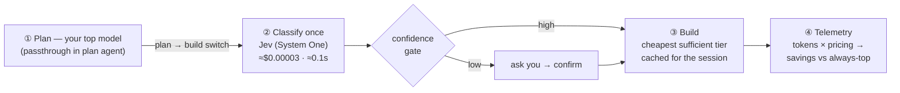

# Smart Router (smartLLMrouter)

**Pick one model in OpenCode. Every session pays less.**

Smart Router turns your coding agent's model selector into a cost lever. Instead of choosing between your expensive planner and a cheap-but-shaky executor, you select a single model — **Smart Router** — and it quietly builds with the cheapest model that is *"good enough"* for the specific task in front of it, on a per-session basis.

> **You only ever pick `smartrouter/auto.`** The plugin registers it as a normal OpenCode model and proxies every request: plan-agent traffic passes through to your top model untouched; when you make the normal plan→build switch, one Jev call classifies the task and the whole session builds on the routed tier. No slash commands, no visible model switching.

> **Explore the full interactive diagram:** [`docs/model-router.html`](docs/model-router.html) — download it and open in a browser (GitHub only renders the file's text). Lanes, cards, and guided views explain every step of the flow.

## Why

Agentic coding bills are dominated by the **build loop** — tool calls, file reads, edits, hundreds of turns. Most sessions don't need the strongest model for that loop; most *do* need it for planning and for the occasional architectural task.

So the decision "which model for this session?" is worth real money — and it's a **classification** question, not a reasoning question:

| Routing an LLM to decide | Routing with a System One classifier (Jev) |
|---|---|
| ~$0.014 per decision (LLM call) | **≈$0.00003 per decision** |
| seconds of latency | **~0.1 s** |
| free-form rationale you must parse | typed answer + probabilities + **calibrated confidence** |

The router tax should be ~0.1% of what it saves — a slower, pricier router would eat its own savings.

## How it works

1. **Plan** — your new session starts in plan mode on whichever top model you configured (astra, opus, mythos…). Smart Router's plugin proxies those requests straight through; you never see a switch.
2. **Classify** — when the plan is done, one Jev call answers typed questions in parallel against the plan digest + repo signals: *exec tier* (choice), *complexity / blast radius / novelty* (three rubric scores), *touches infra / touches security* (boolean checks).
3. **Compose** — pure code turns those answers into a tier: weighted scores, hard overrides (infra/security never route below mid), and a **confidence gate** — high confidence auto-switches, low confidence asks you first.
4. **Build** — the session executes the plan on the routed tier.
5. **Measure** — every decision and token count is logged; a report compares real cost against an "always-top" counterfactual.

## Model tiers

Smart Router routes between the models you connect — e.g. OpenAI models, **GLM-5.3-Flash** ($0.15/$0.50 per 1M) and the free OpenCode Go models:

| Tier | Example | Typical job |
|---|---|---|
| flash | GLM-5.3-Flash, LongCat 2.5 Free | typos, one-file tweaks, boilerplate |
| mid | GPT-6 Luna, GPT-5.5 | features, multi-file changes, tests |
| top | GPT-6 Astra | architecture, migrations, infra/security |

## Early proof (prototype classifier run)

Three sample plans, one Jev call each, tier composed in code:

| Plan | Routed tier | Confidence | Decision cost* | Latency |
|---|---|---|---|---|
| Docs typo | **flash (free tier)** | 0.93 | ≈$0.00003 | 149 ms |
| UI feature | **mid** | 0.82 | ≈$0.00003 | 84 ms |
| Auth + infra | **top** | 0.93 | ≈$0.00003 | 67 ms |

**3/3 correctly separated** — and any of these decisions costs less than one tool call from a GPT-6-class model.

## Roadmap

This lands in **phased PRs** — the first PR (this one) is documentation only:

- **PR 1 (this):** design, diagram, cost case.
- **PR 2:** OpenCode plugin — fake `Smart Router` provider + in-process proxy; plan-agent passthrough on your planner model. *Pick `smartrouter/auto`, everything behaves as your planner.*
- **PR 3:** Jev classification + confidence gate + tier routing across your connected providers (OpenAI / GLM-5.3 / free models).
- **PR 4:** decision log, token telemetry, pricing table, savings report vs the always-top baseline.
- **PR 5+:** failure-escalation (re-route up on repeated build failures), more provider families, extract the router core as a standalone library.

## Security

- Keys are read **from environment variables only** (`TYPESAFE_API_KEY`, `OPENCODE_GO_API_KEY`, …). Nothing is ever written into the repo, and `.gitignore` blocks common secret-file patterns.
- Config values support `env:VARNAME` indirection, so no key ever needs to exist in a file you might commit — **including this repo's own sample configs, which ship as `env:` placeholders**.
- Get a Jev key at `console.typesafe.ai/keys` (TypeSafe AI console).

## License

MIT — see [LICENSE](LICENSE).
