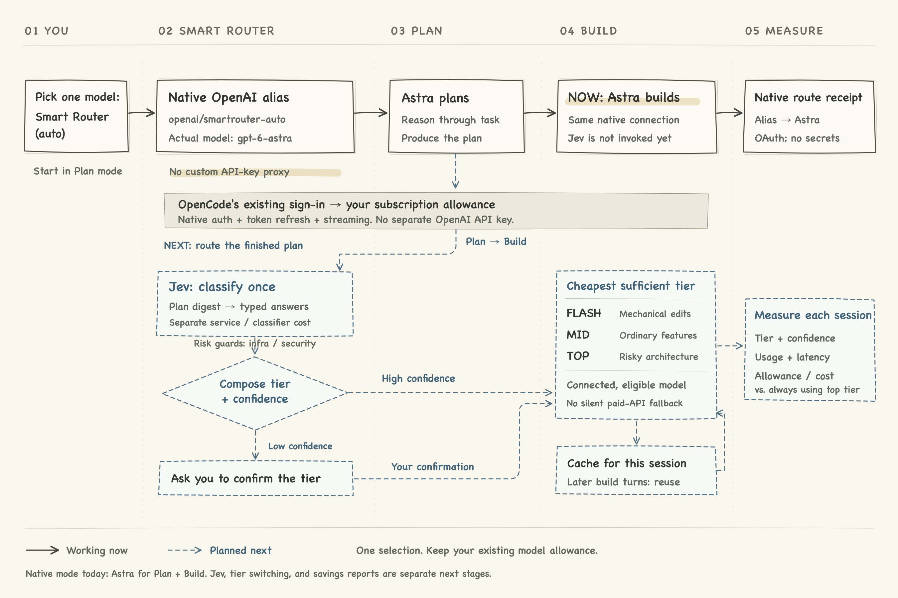

# Smart Router (smartLLMrouter)

**Pick one model in OpenCode. Every session pays less.**

Smart Router turns your coding agent's model selector into a cost lever. Instead of choosing between your expensive planner and a cheap-but-shaky executor, you select a single model — **Smart Router** — and it quietly builds with the cheapest model that is *"good enough"* for the specific task in front of it, on a per-session basis.

> **Live native flow:** select **smartrouter - openai** under **OpenAI** (`openai/smartrouter-auto`; the ID stays stable). **Plan uses Astra. On the first Build instruction, one Jev call chooses an eligible free model or OpenAI Terra/Sol. Astra is never used for Build, including fallback paths.** The picker switches to the actual chosen model and the session shows Jev's decision and confidence. OpenAI uses your existing OAuth allowance; free models use OpenCode's keyless native provider. Jev is a separate classifier service. The label identifies the planner family, not an OpenAI-only Build restriction: GLM/free alternatives remain enabled.

**Diagram review:** [four simpler pencil-flow variants](docs/diagram-variants/README.md). The existing README illustration stays in place until a replacement is selected.




> **Editable pencil drawing:** [`docs/model-router-pencil.svg`](docs/model-router-pencil.svg). Solid lines show the implemented routing; dashed lines show the planned savings report. The [original interactive prototype diagram](docs/model-router.html) is retained as historical design context.

## Why

Agentic coding bills are dominated by the **build loop** — tool calls, file reads, edits, hundreds of turns. Most sessions don't need the strongest model for that loop; most *do* need it for planning and for the occasional architectural task.

So the decision "which model for this session?" is worth real money — and it's a **classification** question, not a reasoning question:

| Routing an LLM to decide | Routing with a System One classifier (Jev) |
|---|---|
| ~$0.014 per decision (LLM call) | **≈$0.00003 per decision** |
| seconds of latency | **~0.1 s** |
| free-form rationale you must parse | typed answer + probabilities + **calibrated confidence** |

The router tax should be ~0.1% of what it saves — a slower, pricier router would eat its own savings.

## Full workflow

1. **Plan** — select Smart Router, then use plan mode. The current native alias uses Astra through your existing OpenCode OpenAI sign-in, without an independently authenticated proxy.
2. **Classify** — the first Build prompt triggers one Jev request using the last finished Plan message and the new instruction. Typed questions choose the **execution family**, **free model**, and **OpenAI model (Terra or Sol)**, plus infra/security risks. Only currently eligible candidates appear in the choices. Repo scanning is not part of this stage.
3. **Gate** — risk guards require OpenAI for infrastructure/security work and Sol for high risk. Confidence is the minimum of the family and selected model confidence. At or above `autoSwitchAt` (default 0.80), routing proceeds automatically; below it, an explicit native permission prompt asks you to approve the model. A denied approval stops Build.
4. **Build** — switch the session to the chosen provider's real model before prompt admission. OpenCode owns its authentication, driver, and streaming. The picker shows the actual model; a session notice shows Jev's result. Cache the decision durably per session, including across plugin reloads. Return to Plan and the router restores Astra; returning to Build reuses the decision.
5. **Observe** — decision, confidence, reason, sanitized structured answers, latency, and actual dispatches are logged. Token/savings reports are still future work.

## Model tiers

Native mode allows these models only when enabled, tool-capable, and eligible. OpenAI requires an active OAuth connection; OpenCode free candidates must have explicitly zero catalog prices. No model API keys are extracted or copied:

| Tier | Example | Typical job |
|---|---|---|
| free | `opencode/glm-5.3-flash-free`, `longcat-2.5-free`, `deepseek-v4.1-flash-free` | mechanical/routine changes |
| OpenAI · Terra | `openai/gpt-6.1-terra` | features, multi-file changes, tests |
| OpenAI · Sol | `openai/gpt-6.1-sol` | architecture, migrations, infra/security |
| Plan only | `openai/gpt-6-astra` | planning; **forbidden in Build** |

Configure the allowlist with `nativeBuildModels`. The router rejects Astra build entries, non-Terra/Sol OpenAI entries, and non-free other-provider entries. Missing Jev credentials, invalid answers, or disappearing models stop execution rather than falling back to Astra or a paid API.

### Live native verification

| Smoke test | Jev result | Confidence | Classifier latency | Result |
|---|---|---|---|---|
| README typo plan | `opencode/longcat-2.5-free` | 0.92 | 167 ms | `BUILD_OK`; next turn `CACHE_OK`, no second classification |
| Auth/billing migration plan | `openai/gpt-6.1-sol` | 0.78 | 80 ms | approval required; after approval, native Sol returned `OPENAI_OK` |

Both tests were no-tools probes and made no task-file changes. These are live observations, not guarantees that every similar plan receives the same classification.

## Early proof (prototype classifier run)

Three sample plans, one Jev call each, tier composed in code:

| Plan | Routed tier | Confidence | Decision cost* | Latency |
|---|---|---|---|---|
| Docs typo | **flash (free tier)** | 0.93 | ≈$0.00003 | 149 ms |
| UI feature | **mid** | 0.82 | ≈$0.00003 | 84 ms |
| Auth + infra | **top** | 0.93 | ≈$0.00003 | 67 ms |

**3/3 correctly separated** — and any of these decisions costs less than one tool call from a GPT-6-class model.

## Roadmap

Rollout order (not PR numbers):

1. **Implemented — OpenCode setting:** native **smartrouter - openai** alias → Astra for Plan → existing OpenAI OAuth allowance.
2. **Implemented — Jev flow:** classify the finished plan once, choose a family/model, apply risk guards, and gate on confidence.
3. **Implemented — post-Jev routing:** switch to the eligible native model before Build dispatch; expose the real model and cache the decision. No Astra Build or automatic paid-API fallback.
4. **Measure and harden:** telemetry, allowance/cost comparisons, failure escalation, additional provider families, and router-library extraction.

### Provider-family entries

| Picker entry | Default Plan model | Build routing | Status |
|---|---|---|---|
| **smartrouter - openai** | Astra | Jev chooses free alternatives or OpenAI Terra/Sol | Implemented; existing ID `openai/smartrouter-auto` is unchanged |
| **smartrouter - anthropic** | Fable | Jev selects among eligible Claude-family build models | Future design only; not registered or implemented |

## Install and test (native subscription mode)

1. **Clone the repo:** `git clone https://github.com/kunalkohli/smartLLMrouter`
2. **Load the plugin** into any OpenCode workspace — symlink it:
   `ln -s <repo-path>/plugin/smartrouter .opencode/plugins/smartrouter`
   …or reference the path in `opencode.jsonc`: `"plugins": ["<repo-path>/plugin/smartrouter"]`
3. **Connect OpenAI** with `/connect` → **OpenAI** → **Sign in with ChatGPT**, if not already connected. Native mode requires OAuth and refuses API-key connections. Usage still counts against your subscription limits.
4. **Configure:** copy `config/smartrouter.example.json` to `.opencode/smartrouter.json`. Keep `"mode": "native"` and `"planner": "openai/gpt-6-astra"`. For Jev, set `TYPESAFE_API_KEY` in the server environment, or add `"typesafeKeyFile": "path/to/private/jev.key"` (resolved from the workspace directory). Keep that file private, preferably outside the repo, and never commit its contents. No OpenAI or Go API key is needed. Legacy `tiers`/`keys` settings are ignored in native mode.
5. In `/models`, select **smartrouter - openai** under **OpenAI** (`openai/smartrouter-auto`). If upgrading from the proxy prototype, cancel its retries and reselect this new entry; old sessions selecting `smartrouter/auto` do not migrate automatically. Renaming this native entry does not invalidate existing native sessions. Config/plugin edits reload automatically; use `/reload` if needed, not a service restart.
6. In **Plan**, send: **“Plan a trivial README typo correction. Do not use tools or change files.”** This uses Astra; the picker displays the Smart Router alias.
7. Switch to **Build**, then send: **“Use that plan for routing, but make no changes and use no tools. Reply exactly BUILD_OK.”** Jev runs on this first instruction, not on the agent toggle alone. Expect a native approval prompt if confidence is low, a **Jev → provider/model · confidence** notice, and the actual chosen model in the picker. Build never uses Astra.
8. Send a second no-tools instruction. Confirm the same model is used and no new `jev.decision` entry is added.

The `prompt` admission hook performs native cross-provider switching; `model.request` guards block stale Astra requests outside Plan and recheck build eligibility. OpenCode's OAuth refresh, native transport, and usage accounting remain in control. Catalog-dollar estimates shown for actual OpenAI models are not proof of separate API billing; these requests still use the existing OAuth connection and consume its allowance.

### Decision logs and controls

- Local log: **`.opencode/smartrouter/decisions.jsonl`** in the workspace. `jev.decision` records the chosen family/model, confidence, sanitized answers, risk guards, and latency. `native.dispatch` records which model was actually sent a request.
- A single Jev notice shows **family choice + confidence**, **Terra/Sol choice + confidence**, and **free-model choice + confidence** (unused branches are labeled conditional), followed by the actual build model and approval-gate confidence. Risk overrides are shown separately. The low-confidence permission prompt includes the same breakdown. `/smartrouter-status` queues this readable breakdown for a cached decision without another Jev call.
- `/smartrouter-reset` clears this session's decision and reselects Smart Router. Send the next Build instruction to classify again. Failures are cached too, so retries do not silently spend on repeated classifier calls.
- Logs contain no prompts, plans, API keys, or OAuth tokens. Classifier decisions are also stored in plugin-local durable storage; logs are gitignored.

### Legacy API proxy (explicit opt-in; separately billed)

The earlier Jev/tier-routing prototype is retained behind `"mode": "api-proxy"`. It registers the old `smartrouter/auto` entry and **does not use ChatGPT subscription allowances**. Only use it if you explicitly want API-key billing:

1. Set `"mode": "api-proxy"` in `.opencode/smartrouter.json`.
2. Export keys into the environment OpenCode runs in:
   - `OPENCODE_GO_API_KEY` — OpenCode Go models (GLM-5.3-Flash, GPT-6 Luna, the free tier)
   - `OPENAI_API_KEY` — your top planner; *without it planning runs on Go and logs the fallback once*
    - `TYPESAFE_API_KEY` — Jev classifier; legacy fallback paths that would execute Astra are blocked too
3. In `/models`, pick the **Smart Router** provider's `smartrouter/auto` entry. Plan as usual; the first build request attempts Jev classification and tier routing.

### Tests

With Node.js 22.18+ (built-in TypeScript support), run:

```sh
node --test test/native-planner.test.ts test/jev.test.ts
```

## Security

- Native model authentication checks connection metadata only; OpenCode owns OAuth secrets and subscription requests. Model API-key fallback is disabled. Jev uses its own explicit credential and receives the bounded plan digest/build instruction.
- Legacy proxy keys are read from environment indirection (`TYPESAFE_API_KEY`, `OPENCODE_GO_API_KEY`, …). Nothing is ever written into the repo, and `.gitignore` blocks common secret-file patterns.
- Config values support `env:VARNAME` indirection, so no key ever needs to exist in a file you might commit — **including this repo's own sample configs, which ship as `env:` placeholders**.
- Get a Jev key at `console.typesafe.ai/keys` (TypeSafe AI console).

## License

MIT — see [LICENSE](LICENSE).
