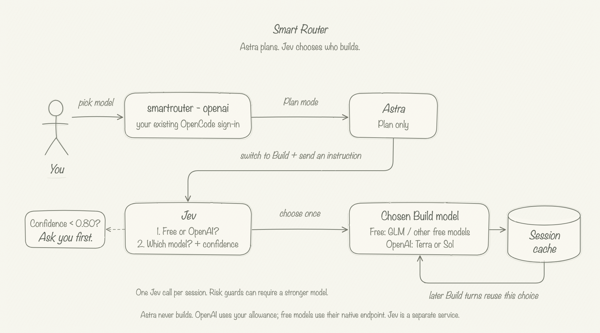
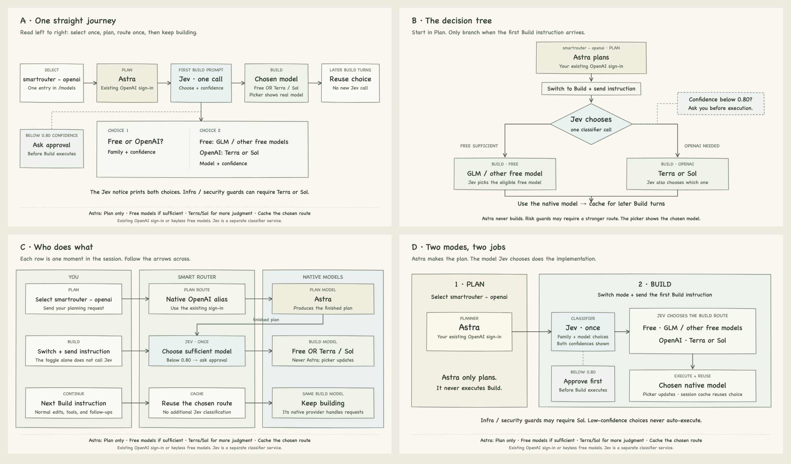
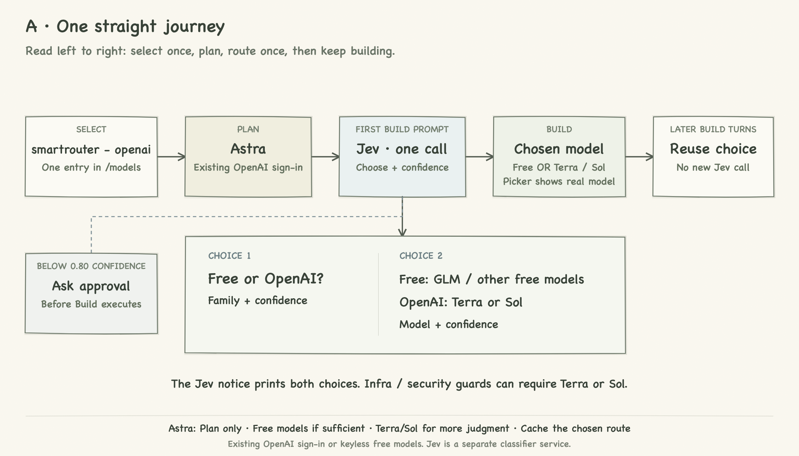
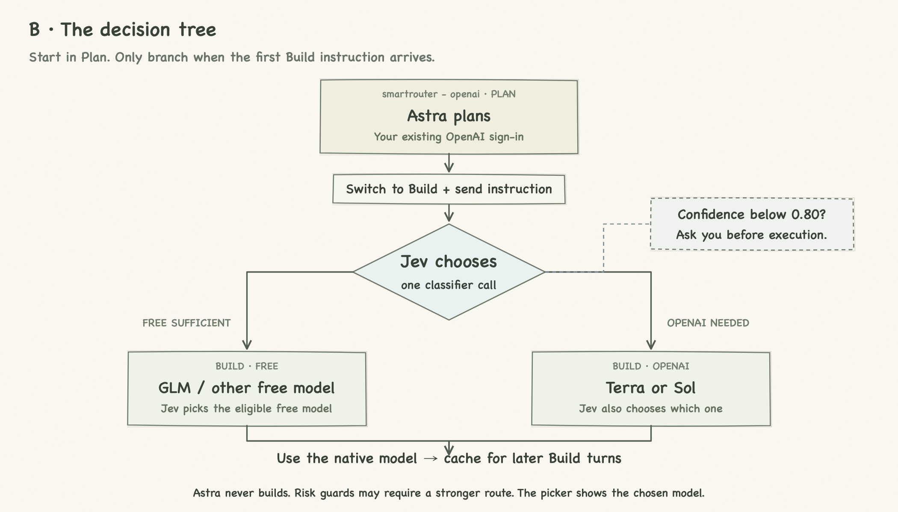
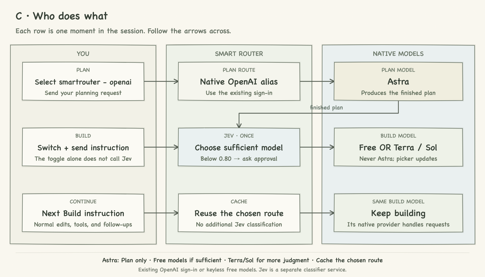
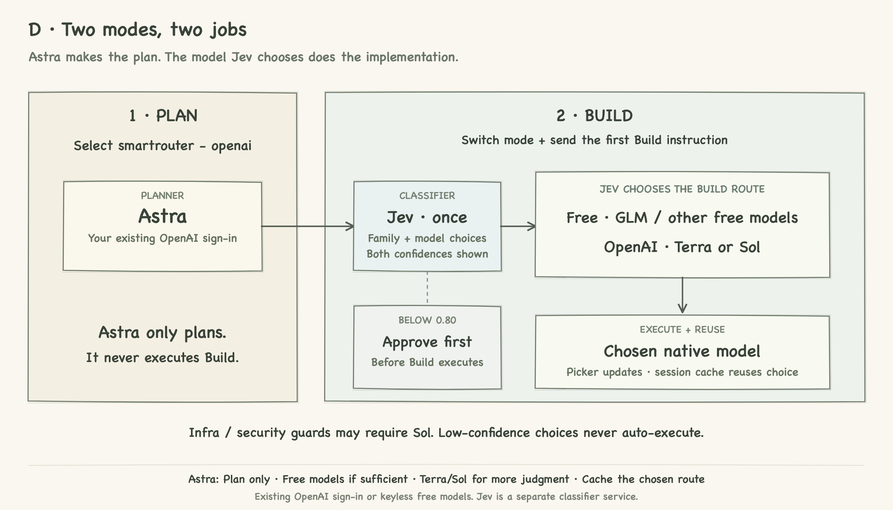

# Pencil flow-diagram options

All options show the **same implemented policy**:

- Pick **smartrouter - openai** → **Plan: Astra**.
- First Build instruction → **one Jev call** → free model **or** OpenAI **Terra/Sol**.
- Below 0.80 confidence: ask for approval. Never use Astra for Build.
- Show the real model and both decision confidences; reuse the session's cached route.

The name identifies the OpenAI planner; GLM/free Build alternatives remain enabled. The future **smartrouter - anthropic** entry (Fable planning, Jev-selected Claude build model) is not part of the current implementation.

## E · User-first pencil sketch — selected for the README

A hand-drawn user, softly sketched rounded boxes, labeled arrows, and a cylinder-shaped session cache. This follows the latest pencil reference rather than the earlier card/architecture layouts.

[Editable SVG](05-user-sketch.svg)

## Earlier options

## A · One straight journey

Minimal left-to-right overview, with the two Jev choices explained below it.

[Editable SVG](01-journey.svg)

## B · Decision tree

Emphasizes when the free/OpenAI branch happens and where approval fits.

[Editable SVG](02-decision-tree.svg)

## C · Who does what

Three rows show Plan, first Build, and subsequent Build turns across the user, router, and native models.

[Editable SVG](03-swimlane.svg)

## D · Two-mode storyboard

Separates planning from implementation, with the Build choice and reuse grouped together.

[Editable SVG](04-storyboard.svg)

The main README uses E. Earlier options are retained for reference. Regenerate A–D and the review gallery with `python3 scripts/draw-flow-variants.py`; E is edited directly in its SVG. Render each SVG in a browser to produce its PNG.
